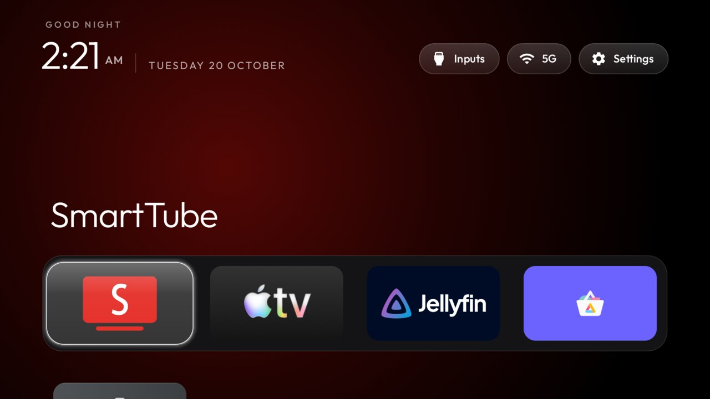
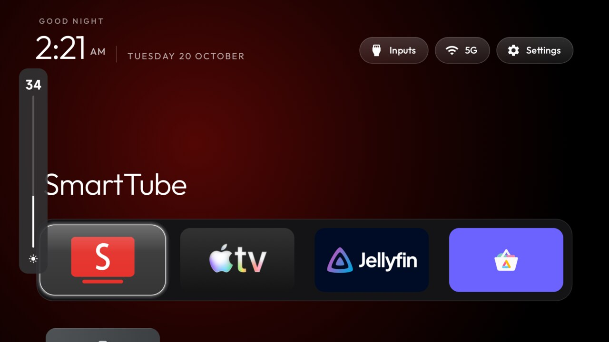
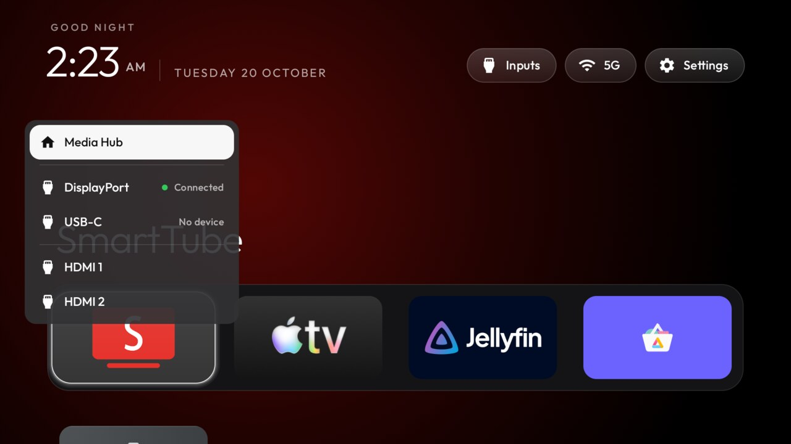
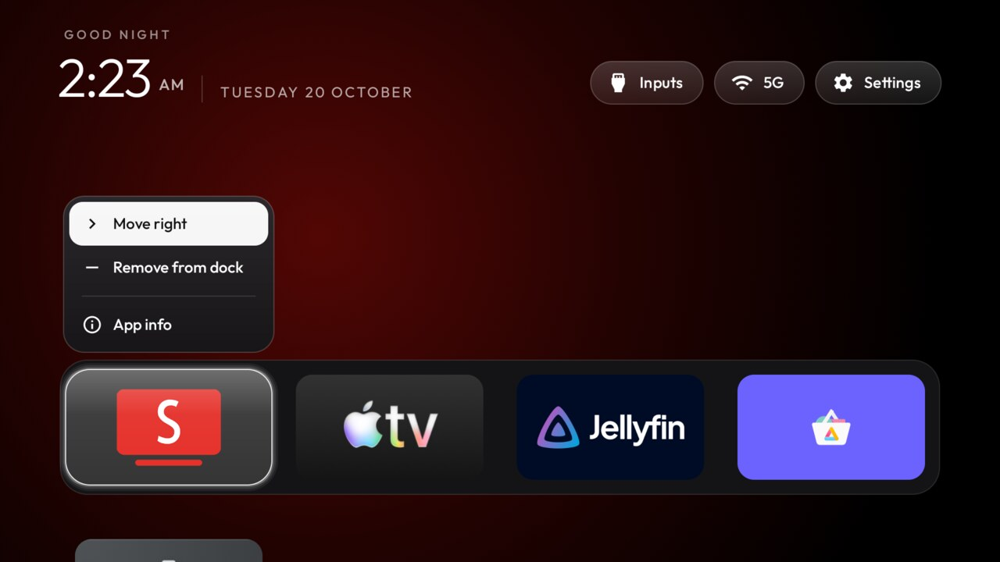

> **This is a fork** of [Gathin23/cleanyourtv](https://github.com/Gathin23/cleanyourtv) (formerly
> tv-vibehack), adapted for the **Redmi G Pro 27U** monitor (MiTV-MFFU1, China HyperOS 3, Android 14) by
> [@aaugmentum](https://github.com/aaugmentum), with Claude Code. On firmware that refuses third-party home
> screens, its launcher still takes over the Home button, and it keeps it after HyperOS standby. It also:
> - switches DisplayPort, USB-C and HDMI through Xiaomi's player
> - opens a brightness bar from the remote's TV button, and an input picker when you hold it
> - types what you say while you hold the remote's mic button, English or Russian, recognised offline on the monitor
> - lets you edit the dock from a tile's menu
>
> Setup and device notes: [examples/redmi-g-pro-27u](examples/redmi-g-pro-27u/). The launcher here targets
> Android 10 (targetSdk 29) for the brightness bar, so Google TV may refuse to install it; for any other TV,
> use the original.

<table>
  <tr><th>Home and dock</th><th>TV button: brightness</th></tr>
  <tr>
    <td></td>
    <td></td>
  </tr>
  <tr><th>Hold TV: input picker</th><th>Tile menu: edit the dock</th></tr>
  <tr>
    <td></td>
    <td></td>
  </tr>
</table>

<p align="center">
  <a href="https://cleanyour.tv"></a>
</p>

<p align="center">
  <a href="https://cleanyour.tv">cleanyour.tv</a> ·
  <a href="PROMPT.md">The prompt</a> ·
  <a href="examples/">30 TV lists</a> ·
  <a href="SHOWCASE.md">Made with it</a> ·
  <a href="https://x.com/gathint/status/2111379569030939102">The tweet</a>
</p>

<p align="center">
  <a href="https://github.com/Gathin23/cleanyourtv/stargazers"></a>
  <a href="https://github.com/Gathin23/cleanyourtv/pulls?q=is%3Amerged"></a>
  <a href="LICENSE"></a>
  <a href="https://buymeacoffee.com/gathint"></a>
</p>

Strip the bloatware from any Android TV or Google TV over Wi-Fi, and replace the ad-filled home
screen with a clean launcher that looks like an Apple TV. **No root, no cable, nothing uninstalled,
and a one-line restore if you change your mind.**


> Vibe coded my parents' TV this afternoon! It was showing a sponsored ad before you could even get
> to Netflix. Gave Claude Code the model number, it found the TV on wifi, removed 25 Xiaomi packages
> and wrote a new launcher. Looks like an Apple TV now lol.
>
> [@gathint, 17 October 2026](https://x.com/gathint/status/2111379569030939102). The replies are where
> most of the TV lists here came from. The repo was called tv-vibehack until the 19th; old links work.

## How it works

Android TVs have the same debug bridge as Android phones. Switch on USB debugging in the TV's
developer options, allow your computer once, and the rest is standard Android tooling:

1. **Back up** the list of installed packages and settings.
2. **Disable** the manufacturer's telemetry, ad services, content rows and preloaded junk with
   `pm disable-user`. Nothing is uninstalled, so a restore script can undo every step.
3. **Install** a small native launcher and make it the default home screen.

The bloat differs by brand, so the prompt has your coding assistant discover it on your TV and ask
before touching anything you might use.

## Quick start

You need a computer on the same Wi-Fi as the TV and a coding assistant with shell access
(Claude Code or similar).

| | |
|---|---|
| **1. On the TV** | Settings → Device Preferences → About → press OK on **Build** seven times → back → Developer options → **USB debugging** on. If you see a Network or ADB debugging toggle, turn that on too. Keep the TV on. |
| **2. On your computer** | Paste [`PROMPT.md`](PROMPT.md) into your assistant and fill in your TV model. |
| **3. Follow along** | Accept "Allow USB debugging?" on the TV, then answer the checklist: which apps you use, which four go in the dock, whether to keep the voice assistant, Chromecast and updates. |

The assistant backs up, debloats, builds and installs the launcher, and checks each step with
screenshots pulled from the TV. With this repo as context it takes about fifteen minutes.

## What you get

- **A pitch-black home** with a dock of your four favourite apps in a rounded band, where Apple TV puts it.
- **A top shelf** naming the focused app in large type, with an ambient glow in a colour taken from its artwork.
- **The rest of your apps in a grid** that slides up when you press Down.
- **One floating glass highlight** that springs from tile to tile. The focused tile lifts and shows its name.
- **Three frosted buttons**: Inputs (HDMI ports, AV, Live TV), Wi-Fi or Ethernet with the network name, Settings.
- **A greeting, a thin clock and the date** in [Outfit](https://fonts.google.com/specimen/Outfit), and a matching Clock screensaver.
- **Themes** that change colours, wallpaper, dock and columns without a rebuild, and **module cards** that let other apps plug a tile in, only with your say-so.

And a TV that stops working against you: no sponsored rows, no "Discover" nags, no analytics
phoning home, no apps you never asked for.

## Supported TVs

Anything running **Android TV** or **Google TV**. Samsung (Tizen) and LG (webOS) run different
systems; see [SHOWCASE.md](SHOWCASE.md) for a webOS port. **Fire TV** takes the debloat half only,
since Fire OS will not hand Home to a third-party launcher. A few China-market TCL sets refuse to
install any launcher at all; their lists say so in the header.

Tested lists from contributors, one folder per model in [`examples/`](examples/):

**Xiaomi** 8 · **TCL** 7 · **Sony** 2 · BenQ · CHiQ · Chromecast with Google TV · Hisense · Insignia Fire TV ·
NVIDIA Shield · OnePlus · Philips · RCA · SANYO · Toshiba Fire TV · Stellamore and XGIMI projectors

<details>
<summary><strong>The full list</strong></summary>

| TV | OS |
|---|---|
| BenQ E55-735 (Changhong AI PONT, DVB96BQ) | Google TV 14 |
| CHiQ AI PONT (DVB93CQ) | Android TV 11 |
| Chromecast with Google TV 4K (sabrina) | Google TV 14 |
| Hisense SmartTV 4K FFM (huangshan, MediaTek) | Android TV 10 |
| Insignia 55" F30 4K Fire TV (NS-55F301NA25, AFTDCT31, duckie) | Fire OS 7 / Android 9 |
| NVIDIA SHIELD TV Pro 2019 (P2897, mdarcy) | Android TV 11 |
| OnePlus TV (D00, Dubai) | Google TV 14 |
| Philips Smart 4K TV (Skyworth, eleonas, MediaTek), India | Google TV 14 |
| RCA AI PONT SA (Changhong, redwood, ISDB92RC; also sold as realme 40-inch) | Android 14 |
| SANYO ATV R2 (SCBC, Realtek RTD285O) | Android TV 9 |
| Sony BRAVIA 4K UR2 (BRAVIA_UR2_4K, MediaTek) | Android TV 10 |
| Sony BRAVIA XBR-65X900E (2017, BRAVIA_ATV2) | Android TV 9 |
| Stellamore T950S projector (Droidlogic be30a3, Amlogic txhd2) | Android 13 |
| TCL 55" 4K Google TV, 2023 (G10, G10_4K_US_NF) | Google TV 12 |
| TCL 65C725 (Smart TV Pro, BeyondTV4) | Android TV 11 |
| TCL 55Q10G Pro (China, tcl_mt5879_cn, MediaTek MT9952) | Android TV 11 |
| TCL ak30a5 (China, Amlogic) | Android TV 9 |
| TCL BeyondTV (India) | Android TV 9 |
| TCL QM6K Pro, 2025 (G08, MediaTek tcl9618) | Google TV 14 |
| TCL Smart TV Pro (G05, G05_4K_US, MediaTek MT5889) | Google TV 11 |
| Toshiba Fire TV (AFTHA004, hazel) | Fire OS 7 / Android 9 |
| XGIMI Horizon S Pro projector (XK03H, xgimigalileo, MediaTek) | Android TV 11 |
| Xiaomi Mi Box S (MIBOX4, oneday), streaming box | Android TV 9 |
| Xiaomi Mi TV (MiTV-MOOQ0, croods) | Android TV 10 |
| Xiaomi Mi TV 4A (MiTV-MOOQ1) | Android TV 10 |
| Xiaomi MiTV-AESP0 stick (aquaman, 1 GB) | Android TV 9 |
| Xiaomi MiTV-AXSO0 (dangal; Mi TV 4C Pro 2019 / 4A Pro) | Android TV 9 |
| Xiaomi MiTV-MOOR2 (venom, MediaTek) | Google TV 11 |
| Xiaomi MiTV-MSSP3 (machuca, MediaTek) | Android TV 11 |
| Xiaomi TV A Pro 75" 2026 (MiTV-MZTU0, river, MediaTek) | Google TV 14 |

</details>

Your TV not here? The prompt discovers the bloat itself. Add your list afterwards and the next
person with your model skips that step: [CONTRIBUTING.md](CONTRIBUTING.md).

## Doing it by hand

Everything the assistant does, you can run yourself. The tools need Python 3 and nothing else.

```bash
python3 -m venv tools/venv && tools/venv/bin/pip install -r tools/requirements.txt
export TV_HOST=192.168.1.50                                   # your TV's IP address

tools/venv/bin/python -I tools/tv.py --probe                 # model, Android version, firmware
tools/venv/bin/python -I tools/tv.py 'pm list packages'      # one shell command on the TV
tools/disable.sh examples/xiaomi-mi-tv-4a/debloat.txt        # apply a debloat list
tools/restore.sh examples/xiaomi-mi-tv-4a/debloat.txt        # undo it, stock launcher back
TV_HOST=192.168.1.50 launcher/build-and-install.sh           # build the launcher and make it Home
tools/theme.sh themes/aurora                                 # push a theme; --reset removes it
```

| Tool | What it does |
|---|---|
| [`tools/tv.py`](tools/tv.py) | Pure-Python ADB client: shell, batch, push, pull. Works where the stock `adb` binary is blocked. |
| [`tools/b64push.py`](tools/b64push.py) | Uploads large files such as APKs in base64 chunks and verifies the checksum. |
| [`tools/disable.sh`](tools/disable.sh), [`restore.sh`](tools/restore.sh) | Apply or undo a debloat list. |
| [`tools/theme.sh`](tools/theme.sh) | Push a folder from [`themes/`](themes/) to the launcher and restart Home. |
| [`launcher/build-and-install.sh`](launcher/build-and-install.sh) | Builds a shrunk release (about 250 KB), installs it, switches Home, and rolls back if Home does not land on it. |

Every script has a PowerShell twin next to it. On Windows with Android Studio installed nothing
else is needed:

```powershell
python -m venv tools\venv; tools\venv\Scripts\python.exe -m pip install -r tools\requirements.txt
powershell -ExecutionPolicy Bypass -File launcher\build-and-install.ps1 -TvHost 192.168.1.50
powershell -ExecutionPolicy Bypass -File tools\disable.ps1 -TvHost 192.168.1.50 examples\xiaomi-mi-tv-4a\debloat.txt
```

The install scripts ask the TV which launcher owns Home and only disable one they recognise
(`tvlauncher` or `launcherx`); pass `STOCK_LAUNCHER=<package>` (`-StockLauncher`) to override, or
`none` to leave it alone.

## The launcher

A small native Android TV app (`com.gathin.tvhome`, about 250 KB installed) in plain Java with
AndroidX RecyclerView and nothing heavier. Built for sets with 1 GB of RAM: no blur, no video, no
network, no background services. It needs JDK 17 and Android SDK platform 34 to build; on macOS,
`brew install openjdk@17 android-commandlinetools` and `sdkmanager "platforms;android-34" "build-tools;34.0.0"`.

- **Configure** in [`config.xml`](launcher/app/src/main/res/values/config.xml): dock order, hidden apps, the Live TV package, columns (tiles shrink from 5 up), rows under the dock, an optional VPN app for the network pill.
- **Themes** set the same keys plus a background colour and a wallpaper from a `config.json` pushed to the TV, no rebuild. Three ship in [`themes/`](themes/), documented there.
- **Language** follows the TV: English, German, Spanish, Catalan, French, Russian, Simplified Chinese, Thai. Android 13+ can set it for the launcher alone: `tools/tv.py 'cmd locale set-app-locales com.gathin.tvhome --locales ca'`.
- **Module cards** let any TV app declare its own tile (label, caption, glow). The launcher asks you once per app, Keep hidden by default, and remembers the answer for that app's signing key and card name. Hold OK on Settings to change your mind. How to make one: [`docs/modules.md`](docs/modules.md); the contract: [`docs/specs/card.md`](docs/specs/card.md).
- **Clock screensaver**: a drifting clock over the glow, so nothing burns in. Pick "Clock" in the TV's screensaver settings, or over ADB:
  `tools/tv.py 'settings put secure screensaver_components com.gathin.tvhome/.ClockDream; settings put secure screensaver_enabled 1'`
- **Remote keys**: an optional accessibility service keeps the remote's Input button working on Google TV (`INPUT_KEY_SERVICE=1` at install), another fixes sticks whose Home key sends ALL_APPS (`HOME_KEY_SERVICE=1`).
- **Navigation** is deliberate: Up and Down move one row, the top buttons never fall through to tiles, the last focused app is remembered, and installing or removing an app refreshes the tiles while Home is open.

## Restoring your TV

Keep the list you applied. The restore script re-enables exactly those packages, puts the stock
launcher back as Home and resets the animation scales:

```bash
TV_HOST=192.168.1.50 tools/restore.sh examples/<your tv>/debloat.txt                                    # Android TV
TV_HOST=192.168.1.50 tools/restore.sh examples/<your tv>/debloat.txt com.google.android.apps.tv.launcherx  # Google TV
```

It leaves the new launcher installed (remove it from the TV's Settings → Apps if you want it gone)
and does not know about packages you disabled outside the list. To switch back later, run the
install script again; it works out which launcher to disable even when Home has fallen back to
Android's chooser. If the TV is unreachable, its own
Settings → Apps page can re-enable packages too.

## When something goes wrong

The full list of things that bit us is in [docs/TROUBLESHOOTING.md](docs/TROUBLESHOOTING.md). The
three that matter most:

- **macOS blocks `adb connect`** ("No route to host") under Local Network privacy. `tools/tv.py` avoids the binary.
- **Disable the stock launcher only after the new one is installed and running**, or Home lands on a factory test app. The install script orders this for you.
- **On Google TV the setup wizard** (`com.google.android.tungsten.setupwraith`) can take Home and crash-loop the system after the stock launcher is disabled. Disable it too, and list it in your `debloat.txt` so restore brings it back. Stuck already? `tools/tv.py 'pm enable --user 0 com.google.android.apps.tv.launcherx'`.

## Questions people ask

**Is this safe? Can it brick the TV?** Nothing is flashed, rooted or deleted; packages are disabled
in the user profile. The risk is disabling something the TV leans on, which is why lists are
applied in small batches with a restore script ready. The TV's own Settings → Apps page can
re-enable packages even without the tools.

**What about firmware updates?** Most lists disable the update service, so updates arrive only when
you re-enable it. If one lands, the worst case is a package coming back and you re-run the script.

**Won't the apps break?** Streaming apps still update through the Play Store, which is left alone.
The launcher just lists what is installed and launches it with intents that have been stable for a decade.

**Isn't ADB access a security hole?** It is one explicit "allow this computer" tap on the TV, the
same as developing an Android app. Switch USB debugging off afterwards; the launcher keeps working.

**AirPlay?** Not from this repo. Chromecast built-in stays for Android phones. For iPhones,
[jqssun/android-airplay-server](https://github.com/jqssun/android-airplay-server) works; an install
script for it is in [PR #84](https://github.com/Gathin23/cleanyourtv/pull/84).

**Can I just download the APK?** Build it with the one-line script; it takes a minute and you
control what goes on your TV. No prebuilt binaries.

## Contributing

The most useful contribution is your TV's debloat list, so the next person with that model does
not have to rediscover it. Launcher improvements and sharper prompt wording are welcome too.
[CONTRIBUTING.md](CONTRIBUTING.md) has the format and the testing we ask for. Built something on
top, a launcher, a port, a theme? Add it to [SHOWCASE.md](SHOWCASE.md).

## Licence

MIT, see [`LICENSE`](LICENSE). The Outfit typeface is under the SIL Open Font License, see
`launcher/FONT-LICENSE-OFL.txt`.
